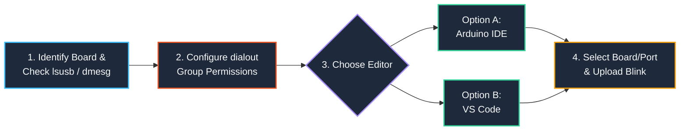

# Arduino Setup & Blink Upload Guide (Ubuntu 26.04 LTS)

### Overview & Summary

This guide walks you through connecting a microcontroller—specifically an **Arduino Uno**, **Adafruit Feather RP2040**, or **Adafruit Feather ESP32**—to **Ubuntu 26.04 LTS**, verifying its USB-to-serial kernel driver (`lsusb` and `dmesg`), configuring serial port access via the `dialout` group, and uploading the built-in **Blink** sketch using either the **Arduino IDE** or **Visual Studio Code (VS Code)**.



## Step 1: Identify the Microcontroller & Kernel Driver (`lsusb`)

### Part A: Visually Identify Your Board First

Before plugging anything in, inspect the physical board—including the **silkscreen text printed on the back**—and match its features against the table below:

| Board Model | Size & Colour | USB Port & Buttons | Distinctive Physical Features | Back Silkscreen Markings |
| :--- | :--- | :--- | :--- | :--- |
| **Arduino Uno** | Large rectangular PCB (credit-card sized), usually blue or teal | Square **USB Type-B** port (or mini/micro on clones); 1 `RESET` button | Long black female pin-header rows along top/bottom edges; round black barrel power jack | Reads **UNO** / **Arduino** (genuine boards include a map of Italy) |
| **Adafruit Feather RP2040** | Small, narrow black PCB with white feather logo & 4 mounting holes | **USB-C** port; **2 tiny pushbuttons** (`BOOT` and `RESET`) | White 2-pin JST battery connector beside the USB-C port; no metal wireless shield | Clearly reads **Feather RP2040** alongside pinout labels |
| **Adafruit Feather ESP32** | Small, narrow black PCB with white feather logo & 4 mounting holes | **Micro-USB** (Huzzah32) or **USB-C** (V2 / S2 / S3); 1 or 2 pushbuttons | **Large silver metal wireless shield/can** on the end opposite the USB port; white JST battery port | Prints the exact variant name (e.g., **Feather ESP32**, **HUZZAH32**, **ESP32 V2**, or **ESP32-S3**) |

### Part B: Check the USB Connection & Kernel Driver (`lsusb` & `dmesg`)

1. Open the Terminal (`Ctrl + Alt + T`) and run `lsusb` **before** connecting your microcontroller to see your baseline USB devices.
2. Plug your board into a USB port on your computer using a **data-capable USB cable** (note: charge-only cables will power the board but will not appear in `lsusb`), then run:
   ```bash
   lsusb
   sudo dmesg -T | tail -n 15
   ```
3. Match your connected board against the reference table below:

### Supported Classroom Boards Reference

| Board Model | Expected `lsusb` Entry | Kernel Driver (`dmesg`) | Typical Serial Port |
| :--- | :--- | :--- | :--- |
| **Arduino Uno** (R3 / Clone) | `Arduino SA Uno R3` (or `QinHeng CH340`) | `cdc_acm` (or `ch341`) | `/dev/ttyACM0` (or `/dev/ttyUSB0`) |
| **Adafruit Feather RP2040** | `Adafruit Feather RP2040` (native USB) | `cdc_acm` | `/dev/ttyACM0` |
| **Adafruit Feather ESP32** | `Silicon Labs CP210x` (or `Espressif USB`) | `cp210x` (or `cdc_acm`) | `/dev/ttyUSB0` (or `/dev/ttyACM0`) |

## Step 2: Configure Serial Port Permissions (`dialout` Group)

By default on Ubuntu 26.04, standard user accounts do not have permission to write to `/dev/ttyACM*` or `/dev/ttyUSB*` serial ports.

1. Add your user account to the **`dialout`** group:
   ```bash
   sudo usermod -aG dialout $USER
   ```
2. > [!warning] Troubleshooting `brltty` Serial Port Conflicts
   > On Ubuntu, the `brltty` (Braille display) daemon frequently claims `CP210x` (Feather ESP32) or `CH340` USB-serial chips and disconnects them immediately. If `dmesg` shows `brltty` grabbing your port, stop the service:
   > ```bash
   > sudo systemctl stop brltty-udev.service
   > ```
3. **Log out and log back in** to Ubuntu so your new group membership takes effect.
4. Confirm you are now in the `dialout` group by running:
   ```bash
   groups
   ```

## Step 3: Open, Configure & Upload the Blink Sketch

Choose **either** Option A (Arduino IDE) or Option B (VS Code) below to open the Blink code, select your board and port, and upload it to the microcontroller.

### Option A: Using Arduino IDE

1. Launch **Arduino IDE** from your application menu or terminal.
2. **Add Board Manager URLs (Required for Adafruit RP2040 & ESP32):**
   * Open **File → Preferences**.
   * In the **Additional Boards Manager URLs** field, paste the following URLs (separated by a comma or on separate lines) and click **OK**:
     ```text
     https://github.com/earlephilhower/arduino-pico/releases/download/global/package_rp2040_index.json
     https://espressif.github.io/arduino-esp32/package_esp32_index.json
     ```
3. **Install the Required Board Core Driver:**
   * Open **Tools → Board → Boards Manager** and install the package matching your board:
     * **Arduino Uno:** Install *Arduino AVR Boards*
     * **Adafruit Feather RP2040:** Install *Raspberry Pi Pico/RP2040/RP2350* (by Earle F. Philhower, III)
     * **Adafruit Feather ESP32:** Install *esp32* (by Espressif Systems)
4. **Open the Blink Code:**
   * Click **File → Examples → 01.Basics → Blink**.
5. **Choose the Correct Board & Port:**
   * Go to **Tools → Board** and select your exact board:
     * *Arduino AVR Boards → Arduino Uno*
     * *Raspberry Pi RP2040 Boards → Adafruit Feather RP2040*
     * *ESP32 Arduino → Adafruit Feather ESP32* (or match the exact variant printed on the back of your board, such as *Adafruit Feather ESP32 V2 / S2 / S3*)
   * Go to **Tools → Port** and select your serial port (`/dev/ttyACM0` or `/dev/ttyUSB0`).
6. **Upload & Verify:**
   * Click the **Upload** button (right-arrow icon `→` in the top-left toolbar).
   * *(Tip: If an RP2040 or ESP32 fails to enter bootloader mode automatically, hold the **BOOT** button while tapping **RESET**, then click Upload again.)*
   * Wait for `Done uploading` and confirm that the onboard LED flashes on and off every 1 second.

### Option B: Using Visual Studio Code (VS Code)

1. Open **VS Code** and ensure the **PlatformIO IDE** extension is installed from the Extensions sidebar (`Ctrl + Shift + X`).
2. **Create a New Project for Your Specific Board:**
   * Open the **PlatformIO Home** tab, click **+ New Project**, and name it `BlinkTest`.
   * In the **Board** dropdown, search for and select your exact board:
     * **Arduino Uno:** `Arduino Uno` (`board = uno`, `platform = atmelavr`)
     * **Adafruit Feather RP2040:** `Adafruit Feather RP2040` (`board = adafruit_feather_rp2040`, `platform = raspberrypi`)
     * **Adafruit Feather ESP32:** `Adafruit ESP32 Feather` (`board = featheresp32`, `platform = espressif32`) — or select `adafruit_feather_esp32_v2` / `adafruit_feather_esp32s3` to match the back of your PCB.
   * Leave **Framework** set to **Arduino** and click **Finish**.
3. **Open the Blink Code (`src/main.cpp`):**
   * In the VS Code Explorer sidebar, open `src/main.cpp` and enter the standard Blink code:
     ```cpp
     #include <Arduino.h>

     void setup() {
       pinMode(LED_BUILTIN, OUTPUT);
     }

     void loop() {
       digitalWrite(LED_BUILTIN, HIGH);
       delay(1000);
       digitalWrite(LED_BUILTIN, LOW);
       delay(1000);
     }
     ```
4. **Verify Board & Serial Port Selection:**
   * Check the bottom blue status bar in VS Code to confirm your selected board environment is active.
   * Click the **Serial Port** selector icon (plug icon) on the bottom status bar and choose `/dev/ttyACM0` or `/dev/ttyUSB0` (or add `upload_port = /dev/ttyACM0` inside `platformio.ini`).
5. **Upload & Verify:**
   * Click the **Upload** button (`→` arrow icon on the bottom status bar) or press `Ctrl + Alt + U`.
   * Confirm the terminal outputs `[SUCCESS]` and verify that the onboard LED blinks at 1-second intervals.

### Practical Observation Checklist & Summary

> [!info] Live Assessment Observation (Criterion 3.3)
> This task is assessed via **direct observation**. Call your assessor over once your board is connected and configured so they can observe the following items in real time:

* **Observable Steps for Assessor Sign-Off:**
  * [ ] **Hardware Identification:** Correctly identify your physical board (**Uno**, **Feather RP2040**, or **Feather ESP32**) and point out its USB device entry in `lsusb`.
  * [ ] **Driver & Permissions Check:** Show `dmesg` confirming the loaded kernel driver (`cdc_acm`, `cp210x`, or `ch341`) and `groups` confirming `dialout` group membership.
  * [ ] **IDE Configuration & Upload:** Demonstrate selecting the matching board and serial port (`/dev/ttyACM0` or `/dev/ttyUSB0`) in **Arduino IDE** or **VS Code** and successfully uploading the **Blink** sketch.
  * [ ] **Functional Verification:** Show the physical microcontroller's onboard LED blinking steadily at 1-second intervals.

* **Key Takeaway:** Visually checking the PCB markings and hardware layout—combined with `lsusb` and `dmesg`—allows you to identify the exact microcontroller and USB-to-serial kernel module (`cdc_acm` or `cp210x`) needed to configure your IDE and upload firmware reliably.