# The Linux Boot Process: A Complete Guide

### Overview: From Power Button to Desktop

When you press the power button on a Linux computer, a strict chain of six handoffs wakes up the hardware, loads the operating system core into memory, and launches your user interface. This guide breaks down the **six core stages** of the Linux boot process—tailored for Year 11 and 12 IT / Digital Technologies students in the ACT—moving from low-level motherboard firmware up to the login screen.

```mermaid
flowchart LR
    A["1. Firmware (BIOS / UEFI)<br/>Runs POST & checks boot order"] --> B["2. MBR / EFI System Partition<br/>Locates stage-1 bootloader code"]
    B --> C["3. Bootloader (GRUB2)<br/>Reads grub.cfg & loads kernel + initramfs into RAM"]
    C --> D["4. Linux Kernel & initramfs<br/>Decompresses kernel, loads drivers & mounts root (/)"]
    D --> E["5. Init System (systemd - PID 1)<br/>Starts background daemons in parallel"]
    E --> F["6. Runlevel / Target & User Login<br/>Reaches graphical.target & opens desktop"]

    style A fill:#1e293b,stroke:#38bdf8,stroke-width:2px,color:#f8fafc
    style B fill:#1e293b,stroke:#38bdf8,stroke-width:2px,color:#f8fafc
    style C fill:#1e293b,stroke:#34d399,stroke-width:2px,color:#f8fafc
    style D fill:#1e293b,stroke:#34d399,stroke-width:2px,color:#f8fafc
    style E fill:#1e293b,stroke:#a78bfa,stroke-width:2px,color:#f8fafc
    style F fill:#1e293b,stroke:#a78bfa,stroke-width:2px,color:#f8fafc
```

### The 6 Stages of the Linux Boot Process

Each stage in the boot sequence acts like a relay runner: it verifies its environment, loads the next piece of software into RAM, and hands over control.

#### Stage 1: Firmware Initialisation (BIOS / UEFI)

When electrical power hits the motherboard, the CPU executes low-level firmware stored on a chip on the board itself—either modern **UEFI** (Unified Extensible Firmware Interface) or legacy **BIOS** (Basic Input/Output System).

* **Power-On Self-Test (POST):** The firmware runs diagnostic checks on essential hardware (RAM, CPU, graphics, storage controllers). If a critical component fails, the motherboard emits beep codes or flashes diagnostic LEDs.

* **Boot Device Selection:** Once POST passes, the firmware checks its configured boot priority list (NVMe SSD, USB drive, or network PXE) to locate a bootable storage device.

* *How to verify:* You see the manufacturer logo or firmware splash screen appear on the monitor without error beeps.

#### Stage 2: MBR or EFI System Partition (ESP)

Once the firmware chooses the primary boot drive, it inspects the very start of that disk to find the bootloader entry point.

* **Legacy BIOS (MBR):** On older systems, BIOS reads the first 512 bytes of the disk—known as the **Master Boot Record (MBR)**—which contains primary partition tables and tiny stage-1 bootloader code.

* **Modern UEFI (ESP):** On modern GPT-partitioned drives, UEFI looks for a dedicated FAT32 partition called the **EFI System Partition (ESP)** (mounted at `/boot/efi` in Linux) and executes an `.efi` binary (such as `grubx64.efi`).

* *How to verify:* The system transitions smoothly past the motherboard logo without showing a *"No Bootable Device Found"* error.

#### Stage 3: The Bootloader (GRUB2)

The MBR or ESP launches the main bootloader—most commonly **GRUB2** (Grand Unified Bootloader version 2).

* **Kernel Selection:** GRUB2 reads its configuration file (`/boot/grub/grub.cfg`) and displays a menu letting you choose between different Linux kernel versions, recovery modes, or dual-boot operating systems (like Windows).

* **Loading into RAM:** Once an entry is selected, GRUB2 loads two critical files from the `/boot` directory into RAM: the compressed Linux kernel image (`vmlinuz`) and a temporary initial RAM filesystem (`initramfs`).

* *How to verify:* The GRUB menu appears briefly on screen (or boots silently into your distribution's splash screen) without dropping to a `grub>` rescue shell.

#### Stage 4: Linux Kernel & `initramfs`

GRUB2 hands full control of the CPU to the Linux kernel, which decompresses itself in memory and takes over direct hardware management.

* **Temporary Filesystem (`initramfs`):** At this instant, the kernel does not yet have the storage drivers needed to read your main SSD (especially if the drive uses encryption or LVM). It mounts the `initramfs` archive in RAM to access essential hardware drivers.

* **Mounting the Real Root (`/`):** Using those drivers, the kernel locates your actual root partition, checks it for filesystem errors, and mounts it as the primary read-only/read-write root filesystem (`/`), discarding `initramfs`.

* *How to verify:* Pressing `Esc` during the boot splash screen reveals scrolling kernel messages showing hardware detection and `Mounted root filesystem`.

#### Stage 5: The Init System (`systemd`)

Once the real root filesystem is mounted, the kernel launches the very first user-space program: `/sbin/init`, which on modern distributions (Ubuntu, Fedora, Debian, Arch) is **systemd**. It is always assigned Process ID **1** (`PID 1`).

* **Parallel Service Startup:** Unlike older sequential init systems (SysVinit), `systemd` reads unit files and starts background services (daemons)—such as networking, logging, audio, and Bluetooth—in parallel to drastically speed up boot times.

* *How to verify:* Running `ps -p 1` in a terminal after logging in confirms `systemd` is running as `PID 1`.

#### Stage 6: Runlevel / Target & User Login

In the final stage, `systemd` brings the operating system to its configured target state (historically known as a *runlevel*) and hands control over to the user.

* **Reaching the Target:** For servers, `systemd` stops at `multi-user.target` (command-line login). For desktop computers, it proceeds to `graphical.target`.

* **Display Manager & Desktop:** `graphical.target` starts the Display Manager (such as GDM on Ubuntu/GNOME or SDDM on KDE), which launches the graphics server (Wayland or X11), authenticates your password via PAM, and loads your desktop shell.

* *How to verify:* The graphical login prompt accepts your password and loads your desktop environment.

### Quick Reference Table: All 6 Stages

| Stage | Key Component | Location / File | Primary Responsibility | 
| ----- | ----- | ----- | ----- | 
| **1. Firmware** | BIOS / UEFI | Motherboard ROM chip | Runs POST hardware checks and selects the boot drive | 
| **2. Disk Boot Sector** | MBR / ESP | Sector 0 or `/boot/efi` | Points firmware to the stage-2 bootloader executable | 
| **3. Bootloader** | GRUB2 | `/boot/grub/grub.cfg` | Presents OS menu; loads `vmlinuz` and `initramfs` into RAM | 
| **4. Kernel** | Linux Kernel | `/boot/vmlinuz-*` | Decompresses, loads drivers via `initramfs`, mounts `/` | 
| **5. Init System** | `systemd` (`PID 1`) | `/sbin/init` | Launches background system services (daemons) in parallel | 
| **6. Target & Login** | Display Manager | `graphical.target` | Starts graphics server, authenticates user, opens desktop | 

### Recommended Video Resources

* [**How Does Linux Boot Process Work? — ByteByteGo**](http://www.youtube.com/watch?v=XpFsMB6FoOs) (4 min 44 sec): A clear, visual walkthrough of every handoff from BIOS/UEFI through GRUB, the kernel, and `systemd`—ideal for quick revision before an assessment.

* [**Linux boot process Explained - Animated — Bit Byte Talks**](https://www.youtube.com/watch?v=lLg0dp9Pic8&t=16s) (12 min 47 sec): An animated step-by-step visual guide breaking down how each component loads and hands over control during startup.

* [**What are the Steps of the Linux Boot Process? — CBT Nuggets**](http://www.youtube.com/watch?v=sOIOY6Ks0xA) (10 min 51 sec): A slightly deeper breakdown explaining bootloaders, kernel files, and init targets in plain language.

### Summary & Key Takeaways

* **A 6-stage relay race:** No single program boots Linux alone. **BIOS/UEFI** checks hardware $\rightarrow$ **MBR/ESP** locates the bootloader $\rightarrow$ **GRUB2** loads the kernel $\rightarrow$ the **Kernel** mounts the root drive $\rightarrow$ **systemd (`PID 1`)** launches background services $\rightarrow$ **Targets & Display Managers** open your user session.

* **Why `initramfs` exists:** The kernel needs a mini filesystem in RAM first so it can load the exact storage drivers required to read your real hard drive.

* **Useful diagnostic commands:** Once logged in, you can inspect your own system's boot performance in a terminal by running `systemd-analyze` (shows total boot time broken down by firmware, loader, kernel, and userspace) or `dmesg` (shows raw kernel boot messages).