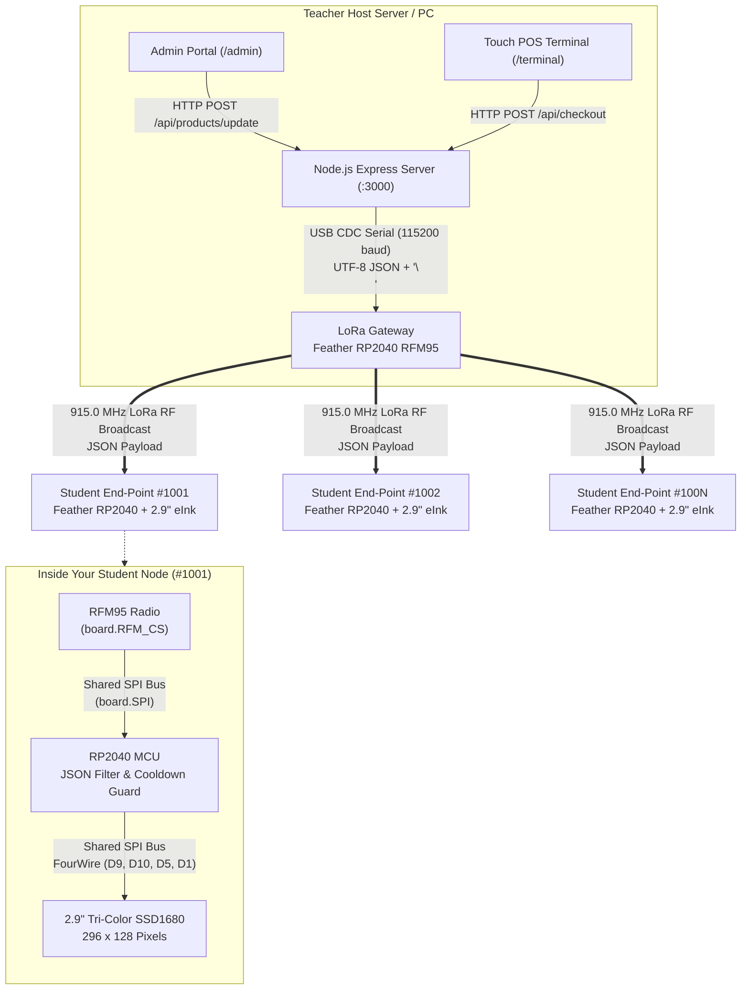

# Project F.A.L.C.O.N. — Student Semester Workbook (Diátaxis Edition)

Welcome to **Project F.A.L.C.O.N.**! Over this semester, you will build, program, and test a wireless **Electronic Shelf Label (ESL)** using an **Adafruit Feather RP2040 RFM95** and a **2.9" Tri-Color eInk FeatherWing**.

This workbook is organized using the **Diátaxis Documentation Framework** so you always know what kind of learning you are doing:
1. **Part I — How-To Setup Guides** *(Task-Oriented)*: Step-by-step instructions to prepare your hardware, flash CircuitPython 10, install libraries, and configure VS Code.
2. **Part II — Staged Semester Tutorial** *(Learning-Oriented)*: Four progressive coding stages that build your firmware from a blank board up to a full wireless retail shelf tag.
3. **Part III — Technical Reference & Explanations** *(Information & Understanding-Oriented)*: Pinouts, SPI bus architecture, RFM95 packet schemas, SSD1680 refresh rules, and troubleshooting tables.

---

# Part I: How-To Setup Guides (Environment & Hardware)

Complete these four setup tasks before beginning Stage 1 of the coding tutorial.

## How-To 1: Flash CircuitPython 10 onto the Feather RP2040

1. **Download the `.uf2` Firmware:**
   * Visit **[circuitpython.org/board/adafruit_feather_rp2040_rfm9x/](https://circuitpython.org/board/adafruit_feather_rp2040_rfm9x/)**.
   * Download the latest stable **CircuitPython 10.x** `.uf2` file for **English (US)**.
2. **Enter Bootloader Mode (`RPI-RP2`):**
   * Connect your Feather RP2040 to your computer with a **data-capable USB-C cable**.
   * **Press and hold** the **`BOOTSEL`** button.
   * **Tap and release** the **`RESET`** button while holding `BOOTSEL`.
   * **Release** `BOOTSEL`. A USB drive named **`RPI-RP2`** will appear on your computer.
3. **Install CircuitPython:**
   * Drag and drop the downloaded `.uf2` file onto **`RPI-RP2`**.
   * Wait 5–10 seconds. The board will automatically reboot and appear as a new USB drive named **`CIRCUITPY`**.

---

## How-To 2: Download and Copy the CircuitPython 10.x Libraries

1. **Download the Library Bundle:**
   * Go to **[circuitpython.org/libraries](https://circuitpython.org/libraries)** and download the **Bundle for Version 10.x** (`adafruit-circuitpython-bundle-10.x-mpy-YYYYMMDD.zip`).
   * Extract (unzip) the downloaded archive completely.
2. **Copy Drivers to `CIRCUITPY/lib/`:**
   * Open the extracted bundle's `lib/` folder and copy **these exact 6 items** into your `CIRCUITPY/lib/` folder:
     * `adafruit_rfm9x.mpy` *(File)*
     * `adafruit_ssd1680.mpy` *(File)*
     * `fourwire.mpy` *(File)*
     * `adafruit_bus_device/` *(Entire folder)*
     * `adafruit_display_text/` *(Entire folder)*
     * `adafruit_bitmap_font/` *(Entire folder)*

---

## How-To 3: Configure Visual Studio Code with the CircuitPython Extension

1. **Install the Extension:**
   * Open **VS Code** and open the Extensions view (`Ctrl+Shift+X` / `Cmd+Shift+X`).
   * Search for **`CircuitPython`** (by *joedevivo*) and click **Install**.
2. **Open Your Board Workspace:**
   * Click **File $\rightarrow$ Open Folder...** and select your **`CIRCUITPY`** drive.
   * Click **Yes, I trust the authors** when prompted.
3. **Select Board & Open Serial Monitor:**
   * In the bottom status bar of VS Code, click **`Choose Board`** and select **`Adafruit Feather RP2040 RFM9x`**.
   * Open the Command Palette (`Ctrl+Shift+P` / `Cmd+Shift+P`) and run **`CircuitPython: Open Serial Monitor`**.
   * Select your Feather's serial port (`COMx` on Windows, `/dev/tty.usbmodem...` on Mac) at **`115200` baud**.

---

## How-To 4: Assemble the Antenna and 2.9" Tri-Color eInk FeatherWing

> ⚠️ **HARDWARE SAFETY WARNING:** **Never power on or transmit with the RFM95 radio unless an antenna is attached!** Operating without an antenna can permanently burn out the RF power amplifier.

1. **Unplug USB power** from your Feather RP2040.
2. **Attach the 915 MHz Antenna:** Snap the uFL-to-SMA adapter onto the gold uFL jack on the Feather and screw on the 915 MHz antenna (or solder an **8.2 cm** solid-core wire into the `ANT` hole).
3. **Stack the Display:** Firmly press the male header pins of your **Feather RP2040 RFM95** into the female stacking headers on the back of the **2.9" Tri-Color eInk FeatherWing**. Ensure all pins align cleanly with zero offset.

---

# Part II: Staged Semester Tutorial (Building Your Firmware)

Do **not** write the entire program at once. Build and test your firmware across **four progressive stages**, verifying each stage in your VS Code Serial Monitor before advancing to the next.

---

## Stage 1: Foundation Code (System Boot, Shared SPI Bus & Heartbeat)

**Learning Goal:** Establish a reliable baseline program that initializes the shared SPI bus safely without pin conflicts, reads your unique Node ID, and prints a live heartbeat to the Serial Monitor.

### Step 1.1: Write the Foundation Firmware
Open `CIRCUITPY/code.py` in VS Code, replace its contents with the code below, and set `MY_NODE_ID` to the 4-digit tag number assigned by your teacher:

```python
import time
import board
import displayio
import microcontroller

# ==============================================================================
# STAGE 1: FOUNDATION & HARDWARE INITIALIZATION
# ==============================================================================
MY_NODE_ID = "1001"        # <-- Replace with your assigned 4-digit Node ID
RADIO_FREQ_MHZ = 915.0     # Australian 915 MHz ISM Band

# Always release displays BEFORE acquiring board.SPI() to prevent 'SCK in use' errors
displayio.release_displays()
spi = board.SPI()

print("=========================================")
print(f"F.A.L.C.O.N. Foundation Boot | Node #{MY_NODE_ID}")
print(f"Shared SPI Bus Ready: {spi}")
print(f"RP2040 Core Temp: {microcontroller.cpu.temperature:.1f} C")
print("=========================================")

heartbeat_count = 0

while True:
    heartbeat_count += 1
    print(f"[HEARTBEAT #{heartbeat_count}] Node #{MY_NODE_ID} alive | Uptime: {time.monotonic():.1f}s")
    time.sleep(5.0)
```

### Step 1.2: Verify Stage 1
* Press **`Ctrl+S`** (`Cmd+S`) to save `code.py`.
* **Expected Result:** Your VS Code Serial Monitor prints `Shared SPI Bus Ready` and logs `[HEARTBEAT #1]`, `[HEARTBEAT #2]`, etc., every 5 seconds with no errors.

---

## Stage 2: Receiving Data from the Server (LoRa RF Module & JSON Parsing)

**Learning Goal:** Activate the onboard RFM95 915 MHz LoRa transceiver on the shared SPI bus, listen for wireless JSON packets broadcast by the teacher's gateway, and filter packets addressed to your `MY_NODE_ID`.

### Step 2.1: Add the LoRa Receiver Module
Update `code.py` to initialize `adafruit_rfm9x` and decode incoming UTF-8 JSON frames:

```python
import json
import time
import board
import digitalio
import displayio
import adafruit_rfm9x

# ==============================================================================
# STAGE 2: LORA WIRELESS RECEIVER & JSON PACKET FILTERING
# ==============================================================================
MY_NODE_ID = "1001"        # <-- Replace with your assigned 4-digit Node ID
RADIO_FREQ_MHZ = 915.0

displayio.release_displays()
spi = board.SPI()

# Initialize RFM95 LoRa Radio on the shared SPI bus
rfm_cs = digitalio.DigitalInOut(board.RFM_CS)
rfm_rst = digitalio.DigitalInOut(board.RFM_RST)
rfm95 = adafruit_rfm9x.RFM9x(spi, rfm_cs, rfm_rst, RADIO_FREQ_MHZ)

print(f"[STAGE 2] Node #{MY_NODE_ID} listening on {RADIO_FREQ_MHZ} MHz LoRa...")

while True:
    packet = rfm95.receive(timeout=1.0)
    if packet is not None:
        try:
            raw_text = str(packet, "utf-8").strip()
            rssi = rfm95.last_rssi
            print(f"[RX | RSSI {rssi} dBm] Raw Payload: {raw_text}")

            # Decode JSON payload: {"id": "1001", "name": "...", "price": 19.95}
            data = json.loads(raw_text)
            target_id = str(data.get("id", ""))

            if target_id == MY_NODE_ID:
                product_name = str(data.get("name", "Unknown"))
                product_price = float(data.get("price", 0.0))
                print(f"  --> [MATCH!] Update for Node #{MY_NODE_ID}: '{product_name}' @ ${product_price:.2f}")
            else:
                print(f"  --> [IGNORE] Addressed to Node #{target_id}")

        except Exception as err:
            print(f"[PARSE ERROR] Invalid packet format: {err}")
```

### Step 2.2: Verify Stage 2
* Save `code.py` and ask your teacher to click **Broadcast** on your Node ID in the Admin Portal (`/admin`).
* **Expected Result:** When a packet arrives, your Serial Monitor prints `[RX | RSSI -XX dBm]` followed by `--> [MATCH!] Update for Node #1001`. Packets for other students print `--> [IGNORE]`.

---

## Stage 3: Displaying Data on the eInk Screen (Basic Display Driver & Cooldown Guard)

**Learning Goal:** Initialize the **SSD1680 2.9" Tri-Color eInk display** (`296 x 128` pixels), display received product names and prices on the physical screen, and enforce a **180-second refresh cooldown** to protect the eInk panel from hardware wear.

### Step 3.1: Add the SSD1680 Display Driver
Update `code.py` to mount the `FourWire` display bus and render basic text onto the eInk screen whenever a new LoRa packet arrives:

```python
import json
import time
import board
import digitalio
import displayio
import terminalio
from fourwire import FourWire
import adafruit_rfm9x
import adafruit_ssd1680
from adafruit_display_text import label

# ==============================================================================
# STAGE 3: BASIC E-INK DISPLAY RENDERING & REFRESH COOLDOWN GUARD
# ==============================================================================
MY_NODE_ID = "1001"        # <-- Replace with your assigned 4-digit Node ID
RADIO_FREQ_MHZ = 915.0
REFRESH_COOLDOWN = 180     # Minimum seconds between physical eInk refreshes

displayio.release_displays()
spi = board.SPI()

# 1. Initialize 2.9" Tri-Color eInk Display (296 x 128)
display_bus = FourWire(
    spi,
    command=board.D10,
    chip_select=board.D9,
    reset=board.D5,
    baudrate=1000000
)

display = adafruit_ssd1680.SSD1680(
    display_bus,
    width=296,
    height=128,
    busy_pin=board.D1,
    rotation=270,
    highlight_color=0xFF0000
)

# 2. Initialize RFM95 LoRa Radio
rfm_cs = digitalio.DigitalInOut(board.RFM_CS)
rfm_rst = digitalio.DigitalInOut(board.RFM_RST)
rfm95 = adafruit_rfm9x.RFM9x(spi, rfm_cs, rfm_rst, RADIO_FREQ_MHZ)

# 3. Create Basic Display Group
group = displayio.Group()

bg_bitmap = displayio.Bitmap(296, 128, 1)
bg_palette = displayio.Palette(1)
bg_palette[0] = 0xFFFFFF
group.append(displayio.TileGrid(bg_bitmap, pixel_shader=bg_palette))

lbl_status = label.Label(terminalio.FONT, text=f"NODE #{MY_NODE_ID} READY", color=0x000000, scale=2, x=10, y=25)
lbl_data = label.Label(terminalio.FONT, text="Waiting for LoRa...", color=0xFF0000, scale=2, x=10, y=65)
group.append(lbl_status)
group.append(lbl_data)

display.root_group = group

def physical_refresh():
    print("[EINK] Executing physical display refresh (~15s)...")
    time.sleep(display.time_to_refresh)
    display.refresh()
    print("[EINK] Display refresh complete.")

# Initial boot draw
physical_refresh()
last_refresh = time.monotonic()
current_name = ""
current_price = -1.0

while True:
    packet = rfm95.receive(timeout=1.0)
    if packet is not None:
        try:
            data = json.loads(str(packet, "utf-8").strip())
            if str(data.get("id", "")) == MY_NODE_ID:
                new_name = str(data.get("name", "Unknown"))
                new_price = float(data.get("price", 0.0))

                if new_name != current_name or new_price != current_price:
                    elapsed = time.monotonic() - last_refresh
                    if elapsed < REFRESH_COOLDOWN:
                        wait_time = int(REFRESH_COOLDOWN - elapsed)
                        print(f"[GUARD] Waiting {wait_time}s cooldown before refreshing eInk...")
                        time.sleep(wait_time)

                    current_name = new_name
                    current_price = new_price
                    lbl_status.text = current_name[:22]
                    lbl_data.text = f"${current_price:.2f} AUD"
                    physical_refresh()
                    last_refresh = time.monotonic()
        except Exception as err:
            print(f"[ERROR] {err}")
```

### Step 3.2: Verify Stage 3
* Save `code.py`. Watch the eInk screen flash black, white, and red to display `NODE #1001 READY`.
* Broadcast an update from the Admin Portal and verify your product name appears in black and price appears in red.

---

## Stage 4: Final Storefront Layout (Word Wrapping, Tri-Color Hierarchy & Barcode UI)

**Learning Goal:** Upgrade the basic display into a commercial-grade retail shelf label featuring automatic 2-line word wrapping for long product names, a large right-aligned red price band (`Scale 4`), a crisp divider rule, a simulated Code-128 barcode strip, and a bottom SKU badge.

### Step 4.1: Complete Production Firmware (`code.py`)
Replace `code.py` with the final production code below:

```python
import json
import time
import board
import digitalio
import displayio
import terminalio
from fourwire import FourWire
import adafruit_rfm9x
import adafruit_ssd1680
from adafruit_display_text import label

# ==============================================================================
# STAGE 4: FINAL PRODUCTION SMART SHELF LABEL FIRMWARE
# ==============================================================================
MY_NODE_ID = "1001"        # <-- Replace with your assigned 4-digit Node ID
RADIO_FREQ_MHZ = 915.0     # Australian 915 MHz ISM Band
REFRESH_COOLDOWN = 180     # SSD1680 eInk safe refresh interval (seconds)

# Color Constants for 2.9" Tri-Color SSD1680
COLOR_WHITE = 0xFFFFFF
COLOR_BLACK = 0x000000
COLOR_RED   = 0xFF0000

# 1. Release Displays & Acquire Shared SPI Singleton
displayio.release_displays()
spi = board.SPI()

# 2. Initialize 2.9" Tri-Color eInk Display (296 x 128 Pixels)
display_bus = FourWire(
    spi,
    command=board.D10,
    chip_select=board.D9,
    reset=board.D5,
    baudrate=1000000
)

display = adafruit_ssd1680.SSD1680(
    display_bus,
    width=296,
    height=128,
    busy_pin=board.D1,
    rotation=270,
    highlight_color=COLOR_RED
)

# 3. Initialize RFM95 915 MHz LoRa Transceiver
rfm_cs = digitalio.DigitalInOut(board.RFM_CS)
rfm_rst = digitalio.DigitalInOut(board.RFM_RST)
rfm95 = adafruit_rfm9x.RFM9x(spi, rfm_cs, rfm_rst, RADIO_FREQ_MHZ)

# ==============================================================================
# 4. CONSTRUCT COMMERCIAL RETAIL UI LAYOUT (296 x 128)
# ==============================================================================
main_group = displayio.Group()

# Layer 0: Crisp White Paper Background
bg_bitmap = displayio.Bitmap(296, 128, 1)
bg_palette = displayio.Palette(1)
bg_palette[0] = COLOR_WHITE
main_group.append(displayio.TileGrid(bg_bitmap, pixel_shader=bg_palette))

# Layer 1: Top Product Title (Black Ink, Scale 2, 2-Line Word Wrapped)
lbl_title = label.Label(
    terminalio.FONT,
    text="UNASSIGNED TAG\nWAITING FOR LORA...",
    color=COLOR_BLACK,
    scale=2,
    x=8,
    y=14,
    line_spacing=1.15
)
main_group.append(lbl_title)

# Layer 2: Middle Hero Retail Price (Tri-Color Red Ink, Scale 4)
lbl_price = label.Label(
    terminalio.FONT,
    text="$0.00",
    color=COLOR_RED,
    scale=4,
    x=120,
    y=74
)
main_group.append(lbl_price)

# Layer 3: Horizontal Divider Line
divider_bitmap = displayio.Bitmap(280, 2, 1)
divider_palette = displayio.Palette(1)
divider_palette[0] = COLOR_BLACK
main_group.append(displayio.TileGrid(divider_bitmap, pixel_shader=divider_palette, x=8, y=102))

# Layer 4: Simulated Code-128 Barcode Strip (Bottom Left)
barcode_bitmap = displayio.Bitmap(110, 18, 2)
barcode_palette = displayio.Palette(2)
barcode_palette[0] = COLOR_WHITE
barcode_palette[1] = COLOR_BLACK

# Deterministic bar pattern seeded from Node ID
seed = sum(ord(c) for c in MY_NODE_ID)
for x in range(110):
    bar_on = ((x * 7 + seed) % 5 in (0, 1, 3)) or x < 3 or x > 106
    for y in range(18):
        barcode_bitmap[x, y] = 1 if bar_on else 0

main_group.append(displayio.TileGrid(barcode_bitmap, pixel_shader=barcode_palette, x=8, y=107))

# Layer 5: Bottom-Right SKU & Frequency Badge
lbl_sku = label.Label(
    terminalio.FONT,
    text=f"SKU: {MY_NODE_ID} | 915MHz",
    color=COLOR_BLACK,
    scale=1,
    x=175,
    y=115
)
main_group.append(lbl_sku)

display.root_group = main_group

# ==============================================================================
# 5. TEXT FORMATTING & SAFE REFRESH HELPERS
# ==============================================================================
def wrap_title(text, max_chars=23):
    """Wraps product titles cleanly across up to 2 lines at Scale 2."""
    words = text.upper().split()
    line1, line2 = "", ""
    for word in words:
        if len(line1) + len(word) + (1 if line1 else 0) <= max_chars:
            line1 += (" " if line1 else "") + word
        elif len(line2) + len(word) + (1 if line2 else 0) <= max_chars:
            line2 += (" " if line2 else "") + word
    return f"{line1}\n{line2}" if line2 else line1

def align_price_right(price_float):
    """Formats price string and right-aligns it on the 296px canvas."""
    price_str = f"${price_float:.2f}"
    # Each character at Scale 4 is 24px wide (6px * 4)
    pixel_width = len(price_str) * 24
    lbl_price.x = max(8, 288 - pixel_width)
    lbl_price.text = price_str

def render_shelf_tag(name, price):
    """Updates UI elements and performs a full tri-color eInk refresh."""
    lbl_title.text = wrap_title(name)
    align_price_right(price)
    print(f"[EINK] Refreshing Tag #{MY_NODE_ID}: '{name}' -> ${price:.2f}")
    time.sleep(display.time_to_refresh)
    display.refresh()
    print("[EINK] Refresh complete.")

# Render initial unassigned state on boot
render_shelf_tag("Unassigned Tag", 0.00)
last_refresh_time = time.monotonic()
current_name = "Unassigned Tag"
current_price = 0.00

print(f"[ONLINE] Shelf Tag #{MY_NODE_ID} ready and listening for LoRa packets...")

# ==============================================================================
# 6. MAIN EVENT LOOP
# ==============================================================================
while True:
    packet = rfm95.receive(timeout=1.0)
    if packet is not None:
        try:
            raw_payload = str(packet, "utf-8").strip()
            rssi = rfm95.last_rssi
            print(f"[RX RSSI {rssi} dBm] {raw_payload}")

            data = json.loads(raw_payload)
            if str(data.get("id", "")) == MY_NODE_ID:
                new_name = str(data.get("name", current_name)).strip()
                new_price = float(data.get("price", current_price))

                # State-change guard: skip refresh if data is unchanged
                if new_name != current_name or new_price != current_price:
                    elapsed = time.monotonic() - last_refresh_time
                    if elapsed < REFRESH_COOLDOWN:
                        wait_sec = int(REFRESH_COOLDOWN - elapsed)
                        print(f"[COOLDOWN] Waiting {wait_sec}s before refreshing eInk...")
                        time.sleep(wait_sec)

                    current_name = new_name
                    current_price = new_price
                    render_shelf_tag(current_name, current_price)
                    last_refresh_time = time.monotonic()
                else:
                    print("[SKIP] Payload identical to current screen state.")
        except Exception as err:
            print(f"[PACKET ERROR] {err}")
```

---

# Part III: Technical Reference & Deep-Dive Explanations

Use this section to understand **why** the firmware is structured the way it is and to diagnose hardware or software issues during lab sessions.

## 1. System Architecture & Data Flow

Project F.A.L.C.O.N. bridges a web-based retail management console to low-power wireless shelf nodes over the unlicensed Australian **915 MHz ISM radio band**:



* **JSON Packet Schema:** Every broadcast transmitted over LoRa is a UTF-8 encoded JSON object terminated by a newline on the gateway:
  ```json
  {"id":"1001","name":"Adafruit Feather RP2040 RFM95","price":32.95}
  ```
* **Broadcast Filtering:** LoRa is a shared broadcast medium—every student tag physically receives every packet sent by the gateway. Your firmware inspects `data["id"]` and discards any frame that does not match `MY_NODE_ID`.

---

## 2. Hardware Pinout & Shared SPI Bus Architecture

Both the **RFM95 LoRa Radio** and the **SSD1680 eInk Display** communicate with the RP2040 microcontroller over the same **SPI (Serial Peripheral Interface)** bus (`board.SCK`, `board.MOSI`, `board.MISO`).

### 2.1 Pin Allocation Table

| Subsystem | Signal | Feather RP2040 Pin | Purpose |
| :--- | :--- | :--- | :--- |
| **Shared SPI Bus** | `SCK` / `MOSI` / `MISO` | `board.SCK` / `MOSI` / `MISO` | High-speed clock & data lines shared by radio and screen |
| **RFM95 LoRa Radio** | `CS` (Chip Select) | `board.RFM_CS` | Selects the LoRa radio during SPI transfers |
| **RFM95 LoRa Radio** | `RST` (Reset) | `board.RFM_RST` | Hardware reset line for the SX1276/RFM95 chip |
| **2.9" eInk Wing** | `EPD_CS` (Chip Select) | `board.D9` | Selects the eInk display controller during SPI transfers |
| **2.9" eInk Wing** | `EPD_DC` (Data/Command) | `board.D10` | Tells the SSD1680 whether SPI bytes are commands or pixel data |
| **2.9" eInk Wing** | `EPD_RESET` | `board.D5` | Hardware reset line for the eInk controller |
| **2.9" eInk Wing** | `EPD_BUSY` | `board.D1` | High while the eInk screen is physically moving ink capsules |
| **2.9" eInk Wing** | `SRAM_CS` | `board.D6` | External SPI SRAM chip select (unused when framebuffer is in RP2040 RAM) |

### 2.2 Why `displayio.release_displays()` Must Come First
When CircuitPython soft-reboots after you save `code.py`, any display bus created in the previous run remains bound to `board.SCK` and `board.MOSI`. Calling `displayio.release_displays()` at the very top of `code.py` frees those pins so `board.SPI()` can be shared cleanly between `FourWire` and `RFM9x`.

---

## 3. Display Coordinate Geometry (`296 x 128` Tri-Color Canvas)

When `rotation=270` is passed to `adafruit_ssd1680.SSD1680`, the native `128 x 296` portrait panel is rotated into a **landscape `296 px` wide $\times$ `128 px` tall** coordinate system with `(0, 0)` at the top-left corner:

```text
(0,0)                                                              (295,0)
  +-------------------------------------------------------------------+
  |  [lbl_title: Scale 2, Black Ink, Max 23 chars/line x 2 lines]     | y = 14..48
  |                                                                   |
  |                                     [lbl_price: Scale 4, Red Ink] | y = 74
  |-------------------------------------------------------------------| y = 102 (2px Divider)
  | [|||||||||||||| Code-128 Barcode]            [SKU: 1001 | 915MHz] | y = 107..125
  +-------------------------------------------------------------------+
(0,127)                                                            (295,127)
```

* **Character Dimensions (`terminalio.FONT`):** The built-in bitmap font is **$6\text{ px}$ wide $\times$ $8\text{ px}$ tall** at `scale=1`.
  * At `scale=2` (Product Title): Each character is **$12\text{ px} \times 16\text{ px}$**, fitting up to **23 characters** inside the `280 px` usable width (`8 px` left/right margins).
  * At `scale=4` (Retail Price): Each character is **$24\text{ px} \times 32\text{ px}$**, allowing `align_price_right()` to calculate exact pixel width (`len(price_str) * 24`) and anchor the price cleanly to the right margin (`x = 288`).

---

## 4. Electrophoretic Display Physics & Cooldown Protection

Unlike LCD or OLED screens, a **Tri-Color eInk (SSD1680)** display moves physical black, white, and red micro-capsules using high-voltage waveforms (~15 seconds per refresh).
* **Zero Standby Power:** Once refreshed, the image remains permanently visible even if you unplug the USB cable or battery.
* **Why `REFRESH_COOLDOWN = 180` is Mandatory:** Refreshing an SSD1680 tri-color panel back-to-back without resting can cause permanent pigment burn-in ("ghosting") or damage the electrophoretic fluid layer. Always keep both the **state-change check** (`new_name != current_name or new_price != current_price`) and the **180-second timer** active in your firmware.

---

## 5. Diagnostic & Troubleshooting Matrix

| Symptom / Error Message | Root Cause | Resolution |
| :--- | :--- | :--- |
| **`ValueError: SCK in use`** | `board.SPI()` was called before `displayio.release_displays()`, or `busio.SPI()` was used instead of `board.SPI()`. | Ensure `displayio.release_displays()` is called before `spi = board.SPI()`. |
| **`ImportError: no module named 'fourwire'`** | In CircuitPython 9/10, `FourWire` moved out of `displayio` into a separate library module. | Copy `fourwire.mpy` from the **CircuitPython 10.x** library bundle into `CIRCUITPY/lib/`. |
| **`ImportError: no module named 'adafruit_rfm9x'`** | Missing radio driver or wrong bundle version (e.g., 9.x `.mpy` on CircuitPython 10). | Copy `adafruit_rfm9x.mpy` and `adafruit_bus_device/` from the **10.x** bundle. |
| **Screen hangs on `display.refresh()`** | `EPD_BUSY` pin mismatch on certain FeatherWing hardware revisions. | Change `busy_pin=board.D1` to `busy_pin=None` in `SSD1680(...)` so the driver uses timed waits. |
| **LoRa packets never arrive (`[RX]` silent)** | Frequency mismatch, missing antenna, or wrong `MY_NODE_ID`. | Confirm antenna is attached, `RADIO_FREQ_MHZ = 915.0`, and `MY_NODE_ID` matches the Admin Portal SKU. |
| **Red price text renders as black** | `highlight_color=0xFF0000` was omitted when initializing `SSD1680`. | Pass `highlight_color=0xFF0000` to `adafruit_ssd1680.SSD1680(...)`. |